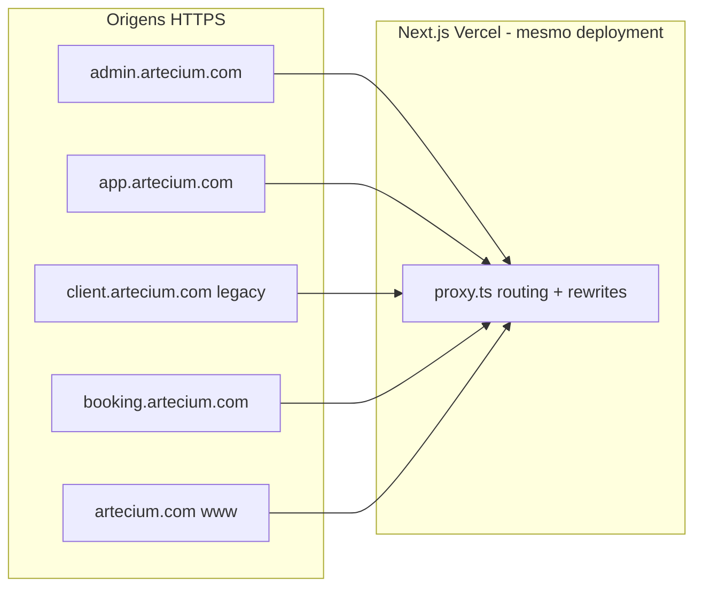

# Fase B — Plano técnico: hostnames, sessão partilhada e roles

**Estado:** plano apenas — **sem implementação** até aprovação após Fase 5.1 concluída.  
**Data:** 2026-11-16  
**Restrições do mandato:** sem deploy, sem alterações em produção, sem mudanças de auth no código nesta entrega.

---

## 1. Objetivos

| # | Requisito |
|---|-----------|
| 1 | `admin.artecium.com` — consola staff/platform |
| 2 | `app.artecium.com` — Área de Cliente (canónico) |
| 3 | Preservar `booking.artecium.com` |
| 4 | Compatibilidade temporária com `client.artecium.com` |
| 5 | Sessão partilhada entre os três (admin, app, booking) onde fizer sentido |
| 6 | Roles independentes **por contexto** (platform vs empresa vs booking) |
| 7 | Proteção da role **Platform Owner** |
| 8 | **MFA obrigatório** para Platform Owner |
| 9 | Separação efectiva **Platform Owner** vs **Platform Admin** |

Referências actuais no código:

- Portal: `DEFAULT_PORTAL_HOSTNAME = "client.artecium.com"` (`src/lib/routing/portal-host.ts`)
- Booking: `src/lib/routing/booking-host.ts`
- Auth SSR: `src/lib/supabase/proxy.ts`, `src/lib/supabase/server.ts`
- Áreas: `src/lib/auth/area-access-policy.ts`, `area-access-resolve.ts`
- Permissões TS: `src/lib/auth/permissions.ts`; BD: `roles`, `user_roles`

---

## 2. Modelo de hostnames (alvo)



| Host | Função | Rotas internas (hoje) | Mudança prevista |
|------|--------|------------------------|------------------|
| `artecium.com` | Marketing + login global | `/`, `/login`, … | Redirect legacy `/client/*` → portal (já parcialmente) |
| `admin.artecium.com` | Staff | `/admin/**` no main host | **Novo** host alias; middleware trata como staff-only |
| `app.artecium.com` | Cliente | rewrite → `/client/**` | **Novo** canónico; substituir default em `portal-host.ts` |
| `client.artecium.com` | Legacy | idem portal | 308 → `app.artecium.com` (path preservado); cookies compatíveis |
| `booking.artecium.com` | Booking SaaS | rewrite → `/booking/**` | Sem alteração funcional |

**DNS / Vercel (fase de implementação):** adicionar `admin` e `app` como domínios no **mesmo** project Vercel; não criar projectos separados (evita divergência de env e simplifies cookies).

---

## 3. Porque o mesmo projeto Supabase ≠ sessão partilhada

Hoje, `createServerClient` em `proxy.ts` e `server.ts` repassa `options` dos cookies **sem** `domain`:

```170:181:src/lib/supabase/proxy.ts
        setAll(cookiesToSet, headers) {
          cookiesToSet.forEach(({ name, value }) =>
            request.cookies.set(name, value),
          );
          // ...
          cookiesToSet.forEach(({ name, value, options }) =>
            supabaseResponse.cookies.set(name, value, options),
          );
```

Cookies host-only (`Domain` omitido) são enviados **apenas** ao host que os definiu. Utilizador que faz login em `artecium.com` **não** leva automaticamente `sb-*-auth-token` para `app.artecium.com`.

**Conclusão Fase B:** é obrigatório um plano explícito de cookie domain + alinhamento de todos os pontos que escrevem sessão Supabase (proxy, Server Actions, route handlers).

---

## 4. Plano de cookies Supabase (proposta)

### 4.1 Domínio

| Ambiente | `Domain` cookie |
|----------|-----------------|
| Produção | `.artecium.com` |
| Preview Vercel | **não** usar parent domain; manter host-only ou cookie de preview isolado |
| Local dev | host-only (`localhost`) ou `hosts` file + TLS opcional |

Implementação: helper único `supabaseCookieOptions(base?: Partial<CookieOptions>)` aplicado em **proxy** e **server** `setAll`, com merge sobre opções que o `@supabase/ssr` já envia.

### 4.2 Secure, HttpOnly, SameSite

| Flag | Valor produção | Nota |
|------|----------------|------|
| `Secure` | `true` | Obrigatório com HTTPS |
| `HttpOnly` | como definido pelo SSR kit | Não alterar manualmente tokens |
| `SameSite` | `Lax` | Subdomínios do mesmo registrable domain — navegação top-level e OAuth return OK |
| `Path` | `/` | Evitar path restrito que impeça leitura em rewrites |

`SameSite=None` só se houver iframe third-party ou POST cross-site; **não** é o caso entre subdomínios Artecium.

### 4.3 Nomes e refresh

Supabase Auth (PKCE + cookies) usa tipicamente pares `sb-<project-ref>-auth-token` (chunked). Refresh ocorre no middleware/proxy via `getUser()` — **todos** os hosts devem executar o mesmo refresh path.

**Risco:** login num host sem `Domain=.artecium.com` cria segundo conjunto de cookies → “sessão partilhada” parece falhar de forma intermitente.

### 4.4 Cookies não-Supabase

| Cookie | Host actual | Acção |
|--------|-------------|--------|
| `LOCALE_COOKIE` | portal/booking | Avaliar `Domain=.artecium.com` para consistência |
| `BOOKING_BUSINESS_COOKIE` | booking | Manter preferencialmente em `booking.artecium.com`; **não** partilhar com admin/app |

### 4.5 Logout global

**Requisito:** terminar sessão Supabase em todos os subdomínios.

Plano:

1. Server action `/logout` (ou endpoint) chama `supabase.auth.signOut({ scope: 'global' })` quando disponível na versão do SDK; senão `signOut()` local + invalidar refresh server-side.
2. Limpar cookies com **mesmo nome** e `Domain=.artecium.com`, `Max-Age=0`, `Path=/`.
3. Redirect para marketing ou login com `next` sanitizado (`sanitizeLoginNext`).
4. **Booking:** se utilizador só tiver sessão booking (cenário futuro), documentar se logout global também remove `BOOKING_BUSINESS_COOKIE`.

### 4.6 OAuth / magic links

Redirect URLs na consola Supabase Auth: incluir `https://admin.artecium.com/**`, `https://app.artecium.com/**`, `https://booking.artecium.com/**`, manter `client.artecium.com` durante transição, `https://artecium.com/**`.

Site URL / additional redirect URLs devem ser actualizados **numa janela** com deploy coordenado (fora desta fase).

---

## 5. Sessão partilhada — matriz de comportamento

| Cenário | Comportamento desejado |
|---------|------------------------|
| Login em `artecium.com/login` → abrir `app.artecium.com` | Autenticado (mesmo user) |
| Staff em `admin.artecium.com` → `booking.artecium.com` | Autenticado; **área** pode negar se sem role booking |
| Cliente em `app` → `admin` | Autenticado mas **redirect** para portal (já pattern staff/client em proxy) |
| Legacy `client.artecium.com` | Mesma sessão que `app` após cookie domain |
| Utilizador sem MFA (owner) acede admin | Bloqueio até MFA completo |

A autorização **não** é global: `resolveUserAreaAccess` continua a separar staff / client / booking mesmo com JWT único.

---

## 6. Roles independentes por contexto

| Contexto | Fonte de verdade | App layer |
|----------|------------------|-----------|
| Platform staff | `user_roles` → `roles.slug` | `permissions.ts`, `/admin` |
| Cliente empresa | `company_users` + RLS | Portal `/client` |
| Contact role empresa | `company_users.contact_role` | UI labels; RLS onde aplicável |
| Booking | `booking_business_members.role` | Booking host only |

**Regra:** um utilizador pode ter `client` + membership booking; o proxy escolhe regras pelo **host**, não pela “última role”.

**Trabalho Fase B (código):**

- Centralizar `resolveHostContext(host): 'marketing' | 'admin' | 'app' | 'booking'`
- Estender `isPortalHostname` → `isAppHostname` com lista `APP_HOSTNAMES = ['app.artecium.com', 'client.artecium.com']`
- Novo `isAdminHostname` para `admin.artecium.com` (redirect `/admin` paths se entrarem pelo main site — decisão UX)

---

## 7. Platform Owner — protecção

### 7.1 Semântica actual

- Slug BD: `owner` (Platform Owner)
- Slug BD: `admin` (Platform Admin)
- Owner tem todas as permissões em `ROLE_PERMISSIONS`; Admin é subconjunto

### 7.2 Ameaças

- Admin remove role `owner` de outro user ou a si próprio via UI/API
- Admin promove-se a `owner`
- Último owner apagado

### 7.3 Controles propostos (camadas)

| Camada | Medida |
|--------|--------|
| BD | Trigger ou policy: apenas `owner` pode INSERT/DELETE em `user_roles` onde `role_id` = owner; `admin` **nunca** atribui `owner` |
| BD | Garantir ≥1 owner (trigger BEFORE DELETE) |
| App | Actions admin usam RPC dedicada em vez de UPDATE directo |
| App | UI: gestão de owners só visível para owners |
| Auth | MFA gate (secção 8) |

Auditar funções `is_owner_or_admin()` — hoje agrupa owner+admin; separar **`is_platform_owner()`** strict para operações sensíveis.

---

## 8. MFA obrigatório — Platform Owner

### 8.1 Supabase Auth

- Activar MFA (TOTP) no project Auth settings.
- Após login, se `user_roles` contém `owner` e `auth.mfa` não verificado → redirect `/admin/security/mfa` (ou login step-up).

### 8.2 Implementação app (fase seguinte)

- Middleware/proxy: após `getUser()`, consultar `user.factors` / AAL (Authenticator Assurance Level) via Supabase.
- Excepção temporária **proibida** em produção para owners.
- Admins: MFA recomendado; obrigatório — **decisão produto** (sugestão: obrigatório para admin também).

### 8.3 Recovery

- Códigos de recuperação Supabase; processo offline para owners (runbook interno).

---

## 9. Platform Owner vs Platform Admin

| Capacidade | Owner | Admin |
|------------|:-----:|:-----:|
| Ver todas empresas (staff) | ✅ | ✅ (com assignments) |
| Gerir utilizadores staff | ✅ | ✅ limitado |
| Atribuir role `owner` | ✅ | ❌ |
| Remover owner | ✅ (com salvaguardas) | ❌ |
| Billing platform / secrets | ✅ | 🟡 configurável |
| Destruir dados cliente | ✅ | 🟡 política |

**Código:** rever `hasAnyStaffRole`, `is_owner_or_admin` RPC usages — trocar checks sensíveis para owner-only.

---

## 10. Compatibilidade `client.artecium.com`

Fases:

1. **B1:** `app` + `client` aceites no proxy (mesma rewrite); links novos apontam para `app`.
2. **B2:** 301/308 de `client` → `app` (excepto OAuth callbacks registados nos dois).
3. **B3:** remover `client` de marketing/SEO quando métricas ≈ zero.

`getPortalBaseUrl()` e Stripe return URLs: actualizar para `app`, manter redirect de legacy.

---

## 11. Booking — sem regressões

- Manter `isBookingHostname` e rewrites actuais.
- Staff que gere booking não deve perder acesso por cookie domain se também forem membros booking.
- Não partilhar cookies de negócio booking com admin.

Testes de regressão (pós-implementação): smoke Phase 4 booking + login professional/owner.

---

## 12. Ordem de implementação sugerida (após aprovação)

1. Helper cookies + feature flag `ARTECIUM_SHARED_SESSION=0|1` (default 0 em prod até cutover).
2. Hostnames Vercel preview staging: `app-staging`, `admin-staging` (opcional).
3. `isAdminHostname` + redirects main site `/admin` → `admin.artecium.com`.
4. `APP_HOSTNAMES` + defaults `app.artecium.com`.
5. Legacy redirects `client` → `app`.
6. BD triggers owner protection + MFA gate.
7. Logout global + documentação OAuth URLs.
8. Remover flag; monitorizar erros 401 cross-subdomain.

---

## 13. Riscos e mitigações

| Risco | Mitigação |
|-------|-----------|
| Dupla sessão (cookies host-only + domain) | Cutover único; script de limpeza cookies antigos |
| Preview Vercel com domain partilhado | Nunca `.artecium.com` em preview |
| CSRF cross-subdomain | SameSite=Lax + POST sensíveis com origin check |
| Owner locked out (MFA) | Recovery codes + segundo owner break-glass |
| Link Supabase errado em `db push` | Runbook Phase 5 + guards |

---

## 14. Critérios de aceitação (Fase B implementada)

- [ ] Login uma vez → `admin`, `app`, `booking` reconhecem o mesmo `user.id` (com cookie domain activo).
- [ ] Cliente não acede `/admin` (redirect).
- [ ] Admin não atribui `owner` sem ser owner.
- [ ] Owner sem MFA não acede consola admin.
- [ ] `booking.artecium.com` Phase 4 scenarios continuam PASS.
- [ ] `client.artecium.com` redirecciona ou serve portal equivalente a `app`.

---

## 15. Dependências

- **Fase 5.1 concluída** com evidências JSON PASS em sandbox.
- Aprovação escrita deste plano.
- Janela para actualizar Supabase Auth redirect URLs (não agora).