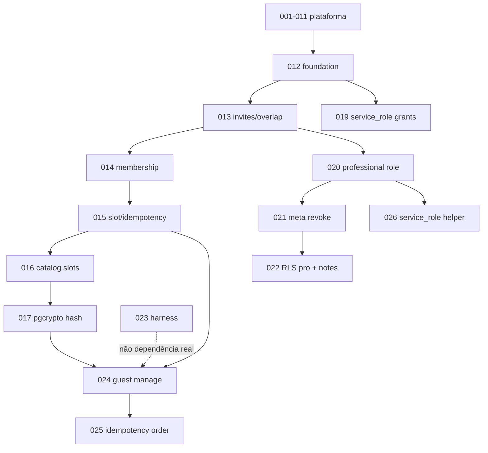

# Booking — matriz de migrações 012–026 (produção)

**Produção alvo (referência):** `bwxhdoxesqtdqwkxrmom`  
**Sandbox validação:** `ahbtpmlrzruwtfcichlg`  
**Fonte:** leitura integral dos ficheiros em `supabase/migrations/` (análise local — sem ligação remota).

Legenda **Prod?**: incluir na sequência de lançamento Booking em produção.

| Versão | Ficheiro | Objetivo (resumo) | Dependências | Prod? |
|--------|----------|-------------------|--------------|-------|
| **012** | `012_booking_foundation.sql` | Schema Booking completo, RLS base, overlap gist, helpers, RPCs iniciais (`booking_public_get_business`, `booking_public_create_appointment`, …) | `001–011` (`profiles`, `companies`, `set_updated_at()`), extensão `btree_gist` | **Sim** |
| **013** | `013_booking_security_invites.sql` | `booking_member_invites`, buffers em overlap (`blocked_*`), redefinição create/invite/accept RPCs | 012 | **Sim** |
| **014** | `014_booking_membership_hardening.sql` | `pgcrypto`; `booking_accept_member_invite(p_token)`; remove policy INSERT membership directa | 013 | **Sim** |
| **015** | `015_booking_public_rpc_hardening.sql` | `idempotency_request_hash`; `booking_validate_public_slot`; create pública endurecida | 014, `pgcrypto` | **Sim** |
| **016** | `016_booking_public_catalog_slots.sql` | RPCs catálogo/slots públicos (`list_services`, `list_staff_for_service`, `list_day_slots`) | 015 | **Sim** |
| **017** | `017_booking_public_idempotency_pgcrypto.sql` | Alinha hash idempotência com `extensions.digest` (pgcrypto) | 015–016 | **Sim** |
| **018** | `018_google_oauth_tokens.sql` | *(Fora do escopo Booking)* tokens Google OAuth — não é migração Booking | — | **Plataforma** (não contar como “Booking 012–026”; ver nota no runbook) |
| **019** | `019_booking_service_role_grants.sql` | `GRANT` service_role em tabelas booking (operações Admin API / seeds) | 012+ | **Sim** |
| **020** | `020_booking_member_role_professional_compat.sql` | Role `professional`; normalização `staff`→`professional`; triggers; RPC invite atualizada | 013–014 | **Sim** |
| **021** | `021_booking_member_role_phase1_meta.sql` | Comentários + `REVOKE EXECUTE` em `booking_normalize_member_role_text` para `public` | 020 | **Sim** |
| **022** | `022_booking_professional_rls_scope.sql` | Notas internas; RLS profissional; views `booking_customers_member`, `booking_time_off_availability`; RPCs disponibilidade membro | 020, tabelas 012 | **Sim** |
| **023** | `023_phase2_harness_persistent_tracking.sql` | Schema `phase2_harness` (testes Phase 2 — cleanup digest, run tracking) | Lê/apaga dados em `booking_customers` / `booking_customer_internal_notes` **apenas dentro de `cleanup_execute` armado** | **Não** |
| **024** | `024_booking_public_guest_manage.sql` | `manage_token` guest; cancel/get/reschedule RPCs; redefine `booking_public_create_appointment` | 015–017 (funções slot/create); coluna `manage_token_hash` já em 012 | **Sim** |
| **025** | `025_booking_public_create_idempotency_before_slot.sql` | Ordem create: lookup idempotência **antes** de `booking_validate_public_slot` | 024 body de create | **Sim** |
| **026** | `026_booking_service_role_member_role_helper_execute.sql` | `GRANT EXECUTE ON booking_normalize_member_role_text TO service_role` | 020 | **Sim** |

## Sequência definitiva em produção (Booking)

```
012 → 013 → 014 → 015 → 016 → 017 → 019 → 020 → 021 → 022
  → [omitir 023]
  → 024 → 025 → 026
```

**Não aplicar em produção:** `023_phase2_harness_persistent_tracking.sql` (ver decisão no runbook principal).

## Artefactos 023 (apenas teste)

| Local | Ficheiro | Uso |
|-------|----------|-----|
| `supabase/migrations/` | `023_phase2_harness_persistent_tracking.sql` | Canónica v2.6 (embedded Postgres / sandbox harness) |
| `supabase/migrations_archive/` | `023_phase2_harness_persistent_tracking_v2.5.sql` | Baseline histórica |
| `supabase/migrations_archive/` | `023_phase2_harness_persistent_tracking_v2.6.sql` | Cópia byte-idêntica à canónica |

---

## Inventário por migração (detalhe)

### 012 — `012_booking_foundation.sql`

| Tipo | Objetos |
|------|---------|
| Extensão | `btree_gist` |
| Tabelas | `booking_businesses`, `booking_business_members`, `booking_business_subscriptions`, `booking_services`, `booking_staff`, `booking_staff_services`, `booking_working_hours`, `booking_staff_breaks`, `booking_time_off`, `booking_customers`, `booking_appointments` |
| Colunas notáveis | `allow_customer_reschedule`, `settings`, `manage_token_hash`, `idempotency_key`, etc. |
| Constraints | slug unique (lower); EXCLUDE overlap staff+time (status pending/confirmed); FKs para `profiles`, `companies` |
| Índices | slug, business, staff, appointments (public_reference, idempotency, starts) |
| Funções | `booking_is_platform_admin`, `booking_can_manage_business`, `booking_can_access_business`, `booking_public_get_business`, `booking_public_create_appointment`, … |
| RLS | ENABLE em todas as tabelas booking; políticas select/manage por membership |
| Grants RPC públicas | `anon`, `authenticated` em get/create iniciais |

### 013 — `013_booking_security_invites.sql`

| Tipo | Objetos |
|------|---------|
| Tabela | `booking_member_invites` |
| Alter | `booking_appointments.blocked_starts_at`, `blocked_ends_at`; novo EXCLUDE em `blocked_*` |
| Trigger | `booking_set_appointment_blocked_range` |
| Funções | `booking_create_business_with_owner`, `booking_public_create_appointment`, `booking_create_member_invite`, `booking_accept_member_invite` (hash token) |
| RLS | invites manager-only |

### 014 — `014_booking_membership_hardening.sql`

| Tipo | Objetos |
|------|---------|
| Extensão | `pgcrypto` |
| Policy | **Remove** `Booking managers write membership` (sem INSERT directo em members) |
| Função | `booking_accept_member_invite(p_token text)` — substitui assinatura hash |

### 015 — `015_booking_public_rpc_hardening.sql`

| Tipo | Objetos |
|------|---------|
| Coluna | `booking_appointments.idempotency_request_hash` |
| Funções | `booking_public_idempotency_request_hash`, `booking_validate_public_slot`, `booking_public_create_appointment` (substitui 013) |

### 016 — `016_booking_public_catalog_slots.sql`

| Tipo | Objetos |
|------|---------|
| Funções | `booking_public_list_services`, `booking_public_list_staff_for_service`, `booking_public_list_day_slots` |

### 017 — `017_booking_public_idempotency_pgcrypto.sql`

| Tipo | Objetos |
|------|---------|
| Função | `booking_public_idempotency_request_hash` (body com `extensions.digest`) |

### 019 — `019_booking_service_role_grants.sql`

| Tipo | Objetos |
|------|---------|
| Grants | DML service_role em tabelas booking; SELECT-only em `booking_customers`, `booking_member_invites` |

### 020 — `020_booking_member_role_professional_compat.sql`

| Tipo | Objetos |
|------|---------|
| CHECK | roles `owner|manager|professional` (members + invites) |
| Funções | `booking_normalize_member_role_text`, triggers normalize, `booking_create_member_invite` |
| Dados | `UPDATE` legacy `staff` → `professional` |

### 021 — `021_booking_member_role_phase1_meta.sql`

| Tipo | Objetos |
|------|---------|
| Metadados | `COMMENT ON` columns/functions |
| Segurança | `REVOKE ALL ON booking_normalize_member_role_text FROM public` |

### 022 — `022_booking_professional_rls_scope.sql`

| Tipo | Objetos |
|------|---------|
| Tabela | `booking_customer_internal_notes` |
| Coluna | `booking_customers.profile_id` (opcional link) |
| Views | `booking_customers_member`, `booking_time_off_availability` |
| Funções | `booking_staff_ids_for_auth_user`, `booking_can_read_full_appointment`, member availability RPCs |
| RLS | políticas appointments/customers/time_off refinadas; notas manager-only |

### 023 — `023_phase2_harness_persistent_tracking.sql` (**não prod**)

| Tipo | Objetos |
|------|---------|
| Schema | `phase2_harness` (isolado; revogado a anon/authenticated/service_role) |
| Tabelas harness | `runs`, `run_tracking`, `cleanup_audit_snapshots`, `deployment_guard` |
| Funções harness | `cleanup_execute`, `compute_cleanup_digest`, `track_fixture_*`, … |
| Toque em prod tables | Apenas em `cleanup_execute` quando `deployment_guard.cleanup_armed` (teste) — **não é API Booking** |

### 024 — `024_booking_public_guest_manage.sql`

| Tipo | Objetos |
|------|---------|
| Funções | `booking_public_manage_token_hash`, guest get/cancel/reschedule, create com `manage_token` |
| Grants | guest RPCs → `anon`, `authenticated` |

*Nota no ficheiro:* “Run AFTER 023” — **comentário enganador**; o SQL **não referencia** `phase2_harness`.

### 025 — `025_booking_public_create_idempotency_before_slot.sql`

| Tipo | Objetos |
|------|---------|
| Função | `booking_public_create_appointment` — reordena lógica idempotência vs slot |

### 026 — `026_booking_service_role_member_role_helper_execute.sql`

| Tipo | Objetos |
|------|---------|
| Grant | `service_role` EXECUTE em `booking_normalize_member_role_text` |

---

## Grafo de dependências (012–026)



---

## Riscos por migração

| Migração | Risco se parcial | Reversível? |
|----------|------------------|-------------|
| 012 | Alto — metade das tabelas | Não sem DROP massivo |
| 013 | Médio — overlap constraint/backfill | Difícil |
| 014 | Médio — policy membership removida | Forward fix |
| 015–017 | Baixo — funções/coluna | Replace function OK |
| 019 | Baixo | REVOKE possível |
| 020 | Médio — CHECK roles | Requer dados compatíveis |
| 022 | Médio — políticas RLS | Forward fix |
| 024–025 | Baixo — só funções (+ semantics create) | Replace function |
| 026 | Baixo | REVOKE |