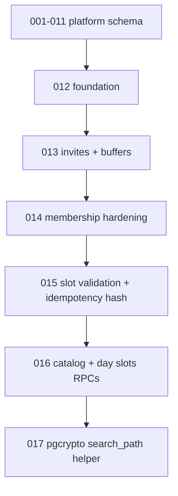

# Artecium Booking — Supabase integration & security validation report

**Date:** 2026-11-01  
**Scope:** Preparation, static RLS/security review, and **attempted** execution of repo test scripts against available env targets.  
**Constraints honoured:** No production migrations, deploy, DNS, or automatic fixes.

---

## Executive summary

| Area | Status |
|------|--------|
| Local Supabase stack (`supabase start` / Docker) | **Not available** on the machine used for this run (no Docker/CLI in PATH, no `supabase/config.toml`) |
| Hosted **allowlisted test** project (`.env.booking.test.local`) | **Reachable**; read-only readiness shows **partial / inconsistent** migration state |
| `npm run test:booking-integration` | **Not executed** (integration seed missing on test project) |
| `npm run test:booking-rls` | **Not executed** (requires local stack + `BOOKING_RLS_USER_*` credentials) |
| Static RLS & RPC review (migrations 012–017) | **Completed** |
| Unit tests (no DB) | **Pass** (`npm run test:booking-unit` — run separately in this phase) |

**Bottom line:** End-to-end integration and RLS **runtime** validation is **blocked** until either (a) local Supabase is stood up with full migration chain + seed, or (b) the allowlisted test project has migrations **012–017** applied cleanly, service-role table access verified, and `db:seed:booking-integration` run **with explicit approval**.

---

## Phase A — Preparation

### A.1 Local Supabase configuration

| Item | Finding |
|------|---------|
| `supabase/config.toml` | **Missing** — repo contains `supabase/migrations/` and `.temp/` only |
| Docker | **Not found** in PATH |
| Supabase CLI | **Not found** in PATH |
| `.env.local` | **Present** (used by Next.js dev; URL not logged in this report) |
| `.env.booking.test.local` | **Present** (template: `.env.booking.test.local.example`) |

See also `docs/booking/LOCAL_ENV_STATUS.md` (earlier audit; still accurate for CLI/Docker).

### A.2 Migrations 012–017 — completeness and order

**Repo order (Booking block):**

| # | File | Purpose |
|---|------|---------|
| 012 | `012_booking_foundation.sql` | Core `booking_*` tables, RLS, GiST overlap, anon revoke, public + owner RPCs |
| 013 | `013_booking_security_invites.sql` | `booking_member_invites`, buffer columns/trigger, hardened create |
| 014 | `014_booking_membership_hardening.sql` | Drop direct membership write policy; fix `booking_accept_member_invite` |
| 015 | `015_booking_public_rpc_hardening.sql` | `booking_validate_public_slot`, idempotency hash column, hardened create |
| 016 | `016_booking_public_catalog_slots.sql` | `booking_public_list_*`, `booking_public_list_day_slots` |
| 017 | `017_booking_public_idempotency_pgcrypto.sql` | `booking_public_idempotency_request_hash` + `search_path` for `digest()` |

**Note:** `018_google_oauth_tokens.sql` is **platform Google OAuth**, not Booking.

**Agency prerequisite:** Migrations **001–011** must exist before 012 (FKs to `profiles`, `companies`; `set_updated_at()`, `is_owner_or_admin()` → `booking_is_platform_admin()`).

### A.3 Migration dependencies (012–017)



- **012 → 013:** Overlap uses `blocked_starts_at` / `blocked_ends_at` (013).
- **013 → 014:** Invites table must exist; 014 removes membership INSERT/UPDATE policy.
- **014 → 015:** Public create expects invite-only membership model.
- **015 → 016:** Slot listing calls `booking_validate_public_slot`.
- **016 → 017:** Create path uses `booking_public_idempotency_request_hash` (017 fixes Supabase `extensions` schema for `digest()`).

### A.4 Seeds and test fixtures

| Asset | Location | When to run |
|-------|----------|-------------|
| Integration seed | `scripts/seed-booking-integration.mjs` | `BOOKING_SEED=1` + env file; **mutates** test DB |
| Fixture definition | `scripts/booking-integration-fixtures.mjs` | Slugs `integration-business-a`, `integration-business-b`, `@artecium.test` users |
| Legacy RLS smoke | `scripts/booking-rls-test.mjs` | Ad-hoc users `BOOKING_RLS_USER_A/B_*`; creates businesses via RPC |
| Demo slug (manual docs) | `artecium-demo` | Documented in `LOCAL_DEVELOPMENT.md`; not guaranteed by integration seed |

**This run:** Integration seed **not** applied (by design — requires explicit approval before writes).

### A.5 Required environment variables

| Variable | Used by |
|----------|---------|
| `NEXT_PUBLIC_SUPABASE_URL` | App + all Booking DB scripts |
| `NEXT_PUBLIC_SUPABASE_PUBLISHABLE_KEY` | Anon client (RLS-bound) |
| `SUPABASE_SERVICE_ROLE_KEY` | Seed, integration admin client, readiness probes |
| `BOOKING_TEST_PASSWORD` | Seed + integration (`≥12` chars) |
| `BOOKING_SEED=1` | Seed script |
| `BOOKING_INTEGRATION_TEST=1` | Integration suite |
| `BOOKING_RLS_TEST=1` | Legacy RLS smoke |
| `BOOKING_RLS_USER_A_EMAIL/PASSWORD`, `BOOKING_RLS_USER_B_*` | RLS smoke only |
| `BOOKING_ALLOW_REMOTE_TESTS=1` | Hosted test project (allowlist) |
| `BOOKING_EXPECTED_PROJECT_REF` | Optional URL/ref guard |
| `BOOKING_DB_READINESS=1` | Read-only readiness |
| `BOOKING_PLATFORM_READINESS=1` | Platform + Booking dependency probe |

**Production credentials:** Not used in this report’s commands.

---

## Phase B — RLS audit (static, migrations 012–014 + grants)

### B.1 Booking tables and RLS enabled

All core tables have RLS **enabled** in 012 (plus `booking_member_invites` in 013):

- `booking_businesses`, `booking_business_members`, `booking_business_subscriptions`
- `booking_services`, `booking_staff`, `booking_staff_services`
- `booking_working_hours`, `booking_staff_breaks`, `booking_time_off`
- `booking_customers`, `booking_appointments`
- `booking_member_invites` (013)

### B.2 Policy model (expected runtime behaviour)

| Role | `booking_can_access_business` | `booking_can_manage_business` | Typical access |
|------|------------------------------|-------------------------------|----------------|
| **owner** | yes | yes | Read/write all business-scoped rows |
| **manager** | yes | yes | Same as owner for RLS |
| **staff** | yes | **no** | **SELECT** on services, staff, hours, appointments, customers; **no** direct INSERT/UPDATE on those write policies |
| **authenticated, no membership** | no | no | No rows on member-scoped tables |
| **anon** | n/a | n/a | **REVOKE ALL** on tables; public flow via **RPC only** |

**Membership writes (014):** Policy `"Booking managers write membership"` **dropped**. Inserts/updates to `booking_business_members` only via **SECURITY DEFINER** RPCs (`booking_create_business_with_owner`, `booking_accept_member_invite`).

**Subscriptions:** Write policy restricted to `booking_is_platform_admin()` (not owner/manager).

**Invites (013):** Managers read/write invites on their business; anon has no table access.

### B.3 Cross-tenant isolation (design)

- Every child row is scoped by `business_id` or join through `booking_staff`.
- Policies use `booking_can_access_business(business_id)` or staff join — user A should not see business B rows.
- **Runtime proof:** Integration script + RLS smoke (not run here).

### B.4 Anonymous public booking

- Direct `SELECT/INSERT` on `booking_appointments` **revoked** for `anon`.
- Allowed: `GRANT EXECUTE` on public RPCs (`booking_public_get_business`, list/create/slots, etc.).
- Create RPC is **SECURITY DEFINER** with validation (015+); response shape omits guest PII (covered in integration tests when run).

### B.5 Third-party appointment mutation

- **Table-level:** `booking_appointments` write policy requires `booking_can_manage_business` → **staff cannot** update status via PostgREST.
- **App layer:** Server actions use `requireManageBusiness()` — staff UI should not expose mutations (static audit in `INTEGRATION_AUDIT.md`).
- **Anon:** No table writes; cannot confirm/reject/cancel via SQL API without RPC (no such public RPC).

### B.6 RLS automated tests — execution status

| Script | Result this run |
|--------|-----------------|
| `BOOKING_RLS_TEST=1 npm run test:booking-rls` | **Skipped** — no local URL + no `BOOKING_RLS_USER_*` configured for this session |
| Coverage when run | Cross-tenant select, overlap EXCLUDE, membership insert denial, anon table block (`scripts/booking-rls-test.mjs`) |

---

## Phase C — Integration tests (planned vs executed)

### C.1 Script coverage (`scripts/booking-integration-test.mjs`)

When seed exists, the suite exercises:

| # | Scenario | In script? |
|---|----------|------------|
| 1 | Create business | Via seed (not create RPC in suite) |
| 2 | Services & staff | Seed + cross-tenant checks |
| 3 | Working hours | Seed + break/slot tests |
| 4 | Time off | Seed + public create rejection |
| 5 | Public availability | `booking_public_list_day_slots` |
| 6 | Public create | `booking_public_create_appointment` |
| 7–9 | Confirm / reject / cancel | **Not in integration script** (admin status updates via app actions only) |
| 10 | Overlapping bookings | Concurrent RPC + blocked slot in list |
| 11 | Idempotency replay | Same payload `replayed=true` |
| 12 | Concurrent same slot | `Promise.all` two creates → one success |

See `docs/booking/INTEGRATION_TEST_COVERAGE.md` for gaps (invites, DST, admin confirm flow).

### C.2 Execution attempts (this run)

| Command | Target | Outcome |
|---------|--------|---------|
| `BOOKING_DB_READINESS=1` + `.env.booking.test.local` | Allowlisted hosted test ref | **Exit 1** — see §C.3 |
| `BOOKING_INTEGRATION_TEST=1` + same env | Hosted test | **Failed immediately:** `Run db:seed:booking-integration first (business A missing)` |
| Local integration / RLS | `127.0.0.1:54321` | **Not attempted** — stack not running |

### C.3 Read-only readiness findings (hosted test project)

Probe used **service role** client from env file. Summary (no secrets):

| Migration | Signal |
|-----------|--------|
| **012** | RPC `booking_public_get_business` **ok**; REST `select` on `booking_businesses` / `booking_appointments` → **`permission denied`** |
| **013** | Table/column probes → **`permission denied`** |
| **014** | RPC `booking_accept_member_invite` **ok** |
| **015** | RPC probe `booking_validate_public_slot` **missing** (probe calls 0-arg signature; function requires args — may be false **missing**) |
| **016** | `booking_public_list_services`, `booking_public_list_day_slots` **ok** |
| **017** | `booking_public_idempotency_request_hash` probe → **permission denied** (function may be internal-only; 017 file has no `GRANT` to anon/service) |

**Interpretation (recommended follow-up, not fixed here):**

1. Confirm `SUPABASE_SERVICE_ROLE_KEY` in `.env.booking.test.local` matches the test project (not publishable key).
2. If key is correct, apply or repair **GRANT**s from 012 (`grant select, insert, … to authenticated`) and default Supabase **service_role** privileges — partial manual SQL can leave tables visible to PostgREST but deny `service_role`.
3. Apply **017** if public create fails with `digest()` / idempotency errors in staging.
4. Re-run readiness until all table probes **ok** before seed/integration.

---

## Phase D — Security review (static + readiness)

### D.1 Service role usage

| Area | Finding |
|------|---------|
| Booking server actions | Use **`createClient()`** (user session) + RLS — **no** `createAdminClient()` in `src/lib/actions/booking/*` |
| Service role | **`src/lib/supabase/admin.ts`** — `server-only`; used by admin/stripe/google scripts, **not** Booking mutations |
| Test scripts | Service role for seed/admin reads — acceptable for CI/local with guards |

### D.2 Public API validation

- **015:** `booking_validate_public_slot` — working hours, breaks, time off, buffers, active service/staff.
- **016:** Day slots RPC iterates grid and calls validator.
- **012/013:** Transactional public create with overlap EXCLUDE on blocked window.
- **TS layer:** `public-slot-validation.ts`, idempotency helpers (unit-tested).

### D.3 Rate limiting

- **No** application-level rate limiting on public booking RPC routes or `/booking/b/[slug]` in this repo.
- **Recommendation:** Edge/WAF or Supabase/API gateway limits (documented in `IMPLEMENTATION_STATUS.md` pre-production list).

### D.4 Enumeration

| Vector | Mitigation (design) |
|--------|---------------------|
| Business slug | Only **active** businesses returned by `booking_public_get_business`; inactive hidden (integration test when run) |
| Customer PII | Public RPC responses omit guest email/phone fields; anon cannot `select` customers table |
| Slot scraping | Public list RPCs require valid slug + service/staff IDs — still enumerable with knowledge of slug (product risk) |

### D.5 SECURITY DEFINER RPCs

Common pattern: `security definer` + `set search_path = public` (or `public, extensions` in 017).

| Function | Caller | Notes |
|----------|--------|-------|
| `booking_public_create_appointment` | anon, authenticated | Must not expose arbitrary column writes; hardened in 013/015 |
| `booking_create_business_with_owner` | authenticated | Creates business + owner membership — **open tenant creation** (product/abuse risk) |
| `booking_accept_member_invite` | authenticated | Token + email match (014) |
| `booking_can_*` helpers | authenticated | Used inside policies |

**Review recommendation:** Periodic SQL audit of DEFINER bodies for `auth.uid()` checks and business_id scoping (see existing `MIGRATION_012_SECURITY_REVIEW.md`, `SECURITY_AUDIT_REPORT.md`).

### D.6 Privileged fields on public create

Public RPC accepts guest fields and slot parameters only; status/confirmation mode derived server-side in SQL. **Staff cannot** escalate via anon path. **Managers** change status through authenticated writes (RLS + app guards).

---

## Phase E — Test results ledger

| ID | Test | Method | Result |
|----|------|--------|--------|
| E1 | Migration files 012–017 present & ordered | Repo inspection | **Pass** |
| E2 | Local Supabase running | CLI/Docker | **Fail** — not installed/running |
| E3 | `check:booking-db-readiness` | Executed on hosted test env | **Fail** — permission/missing probes (§C.3) |
| E4 | `test:booking-integration` | Executed | **Fail** — seed missing |
| E5 | `test:booking-rls` | — | **Skipped** |
| E6 | RLS policy static audit | SQL review | **Pass** (design consistent) |
| E7 | Confirm/reject/cancel via DB/API | Script coverage | **Not automated** — manual or future test |
| E8 | `test:booking-unit` | No DB | **Pass** (expected; run in CI locally) |

---

## Problems found

1. **No local Supabase** — cannot run full integration/RLS without Docker + CLI + `supabase db reset`.
2. **Hosted test project** — readiness **errors** on service-role table SELECT; possible wrong key or incomplete grants/migrations.
3. **017** may be unapplied or helper not granted — probe denied; public create may fail without 017 on Supabase hosted.
4. **Integration seed not present** — suite cannot run until `BOOKING_SEED=1` (approved).
5. **Admin lifecycle gaps** — confirm/reject/cancel not in `booking-integration-test.mjs`.
6. **No rate limiting** on public booking (infrastructure/product).
7. **Docs drift** — some docs stop at 016; **017 required** for idempotency hash on hosted Postgres.

---

## Security findings (no auto-fix)

| Severity | Finding |
|----------|---------|
| **High (ops)** | Test project readiness failures — risk of **thinking** migrations are complete when service role cannot administer tables |
| **Medium (product)** | Open business creation RPC for any authenticated user |
| **Medium (ops)** | No rate limiting on public booking |
| **Low** | Slug enumeration for active businesses |
| **Mitigated (design)** | Anon table revoke + RPC-only public write; tenant RLS; 014 membership hardening; overlap EXCLUDE |

---

## Migrations recommended (test project only — after approval)

1. Verify **001–011** on test project (`check:booking-platform-dependencies`).
2. Apply **012 → 013 → 014 → 015 → 016 → 017** in order (`MIGRATION_012_016_EXECUTION_PLAN.md` + 017).
3. Re-run `BOOKING_DB_READINESS=1` until probes green.
4. Run seed → integration → optional RLS smoke.

**Do not apply to production** as part of this phase.

---

## Recommended corrections (awaiting approval)

1. **Environment:** Install Docker + Supabase CLI; `supabase init` + `supabase start` + `supabase db reset` locally **or** fix test project keys/grants and finish 012–017.
2. **Readiness script:** Adjust RPC probe for `booking_validate_public_slot` to use typed args (reduce false **missing**).
3. **Integration tests:** Add cases for owner **confirm/reject/cancel** via authenticated client (mirror app actions).
4. **RLS smoke:** Run after local reset with two users; or rely on integration seed roles.
5. **Production hardening:** Rate limits, email notifications, optional subscription gating (out of scope here).

---

## Commands to run when unblocked

```powershell
# Local (preferred)
supabase start
supabase db reset
copy .env.booking.test.local.example .env.booking.test.local
# Fill LOCAL keys from: supabase status

$env:BOOKING_SEED = "1"
node --env-file=.env.booking.test.local scripts/seed-booking-integration.mjs

$env:BOOKING_INTEGRATION_TEST = "1"
node --env-file=.env.booking.test.local scripts/booking-integration-test.mjs

$env:BOOKING_RLS_TEST = "1"
# + BOOKING_RLS_USER_A/B_* 
npm run test:booking-rls
```

```powershell
# Hosted test (allowlisted only, after migrations + approval)
$env:BOOKING_DB_READINESS = "1"
node --env-file=.env.booking.test.local scripts/booking-db-readiness.mjs
```

---

**No schema changes, seeds, or application fixes were applied in this phase.**  
Awaiting your approval before migrations on the test project, seed, integration run, or code/SQL corrections.
